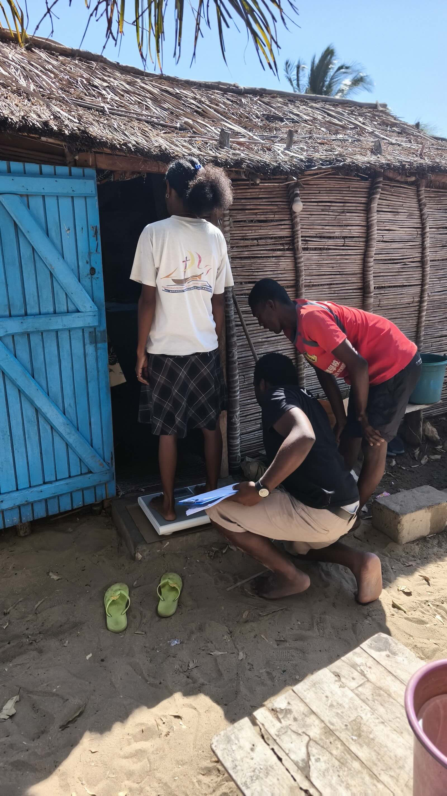
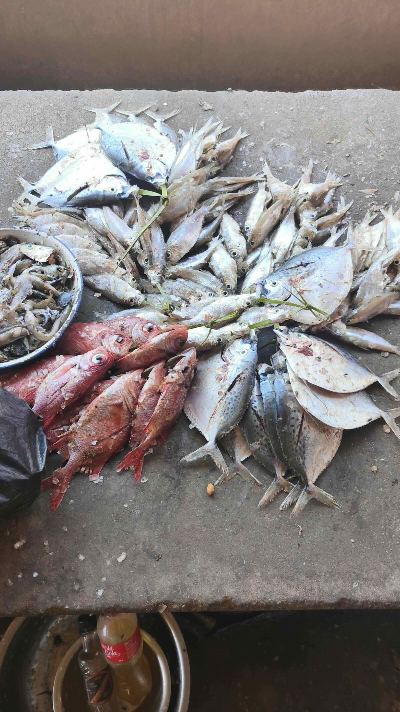
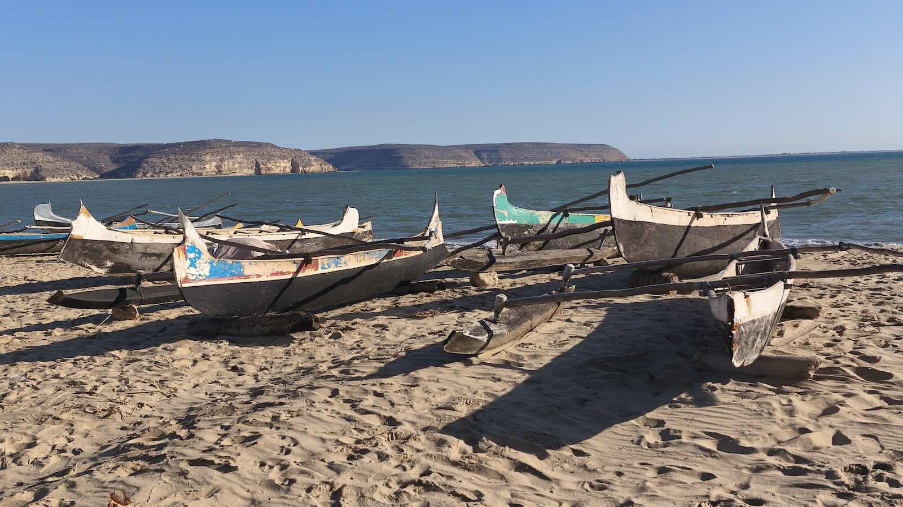
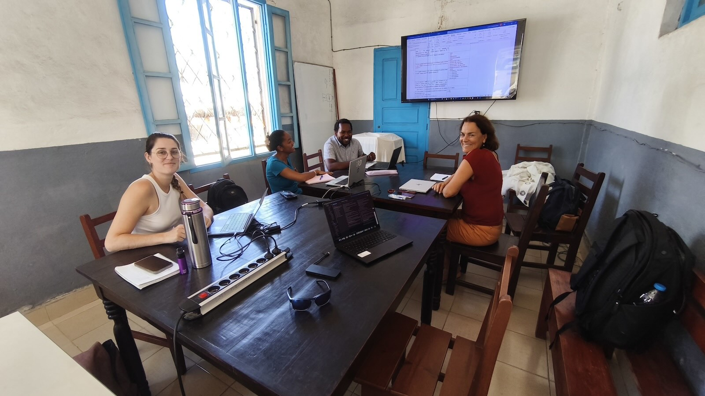

I just got back from three weeks of fieldwork in southwest Madagascar with IH.SM (University of Toliara), the first of which was entirely dedicated to the [AQUANUT](/projects/2026-aquanut/index.qmd) project.

::: {.callout-note appearance="simple" title="At a glance"}
<i class="fa-solid fa-location-dot"></i> Toliara & Saint-Augustin, southwest Madagascar
<i class="fa-solid fa-clipboard-list"></i> Revising survey questionnaires with Léono Todimazava and the team
<i class="fa-solid fa-flask"></i> Pilot study in Saint-Augustin to test the questionnaires in real conditions
<i class="fa-solid fa-fish"></i> Market visits as part of our aquatic food monitoring
:::

## Why AQUANUT?

Aquatic foods are an essential source of protein and micronutrients for vulnerable populations, even hundreds of kilometres inland. Yet they remain largely invisible in nutrition surveys, and their nutritional and food-safety quality is poorly documented in Madagascar.

AQUANUT assesses their contribution to the nutrition security of women of reproductive age and young children (6 to 23 months) across six sites in the Atsimo-Andrefana region, three coastal and three inland. Consumption surveys, market monitoring, and nutritional analyses of aquatic products will help us co-develop tailored dietary recommendations with local communities.

The project supports the PhD of *Léono Todimazava* (IH.SM, University of Toliara; IRD ARTS fellowship), with the team: **Claire Mouquet-Rivier** (IRD, UMR QUALISUD), **Jamal Mahafina** (IH.SM), Gédice Fernand (IH.SM), **Anne-Marie Randrianarivelo** (IH.SM), **Faustine Rio-Puygrenier** (IRD, UMR QUALISUD), and **Andry Razakandrainy** (GRET). A partnership between **IRD**, **UNICEF Madagascar**, **IH.SM**, and **GRET**.

::: {layout-ncol=2}

:::