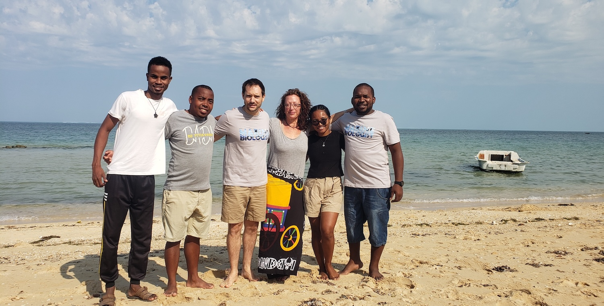

{.people-hero}

I have the chance to work with a talented group of students and researchers across France, Madagascar, and beyond. Since 2022, as an IRD researcher, I have been supervising the people below, at the interface of marine ecology, small-scale fisheries, and food security.

## Current team

::: {.people-grid}

::: {.person-card}

[Léono Todimazava]{.person-name}
[PhD student]{.person-role}
[2025 – 2028]{.person-dates}
Aquatic foods and maternal-child nutritional security in southern Madagascar. Started as an MSc student on FISHTAIL.
[AQUANUT]{.person-project}
[<i class="fa-solid fa-envelope"></i>](mailto:leonodtodimazava@gmail.com){title="Email"} [<i class="fa-solid fa-arrow-up-right-from-square"></i>](#){target="_blank" title="Profile"}
:::

::: {.person-card}

[Estephe Kana Djifacka]{.person-name}
[PhD student]{.person-role}
[2022 – 2026]{.person-dates}
Statistical-learning approaches for modeling marine ecosystems from environmental DNA. Started as an MSc student on AIME.
[AIME]{.person-project}
[<i class="fa-solid fa-envelope"></i>](mailto:kanaestephe@gmail.com){title="Email"} [<i class="fa-solid fa-arrow-up-right-from-square"></i>](#){target="_blank" title="Profile"}
:::

::: {.person-card}

[Isaac Beber]{.person-name}
[PhD student]{.person-role}
[2026 – 2028]{.person-dates}
Life-cycle diversity and functional connectivity of the blacktail seabream in South Africa.
[CIFRE]{.person-project}
[<i class="fa-solid fa-envelope"></i>](mailto:isaac.beber@etu.unice.fr){title="Email"} [<i class="fa-solid fa-arrow-up-right-from-square"></i>](#){target="_blank" title="Profile"}
:::

::: {.person-card}

[Théo Eychenne]{.person-name}
[PhD student]{.person-role}
[2025 – 2028]{.person-dates}
Biocultural approach to marine ecosystem conservation in the Western Indian Ocean under climate change.
[GDR OMER]{.person-project}
[<i class="fa-solid fa-envelope"></i>](mailto:theo.eychenne@cnrs.fr){title="Email"} [<i class="fa-solid fa-arrow-up-right-from-square"></i>](#){target="_blank" title="Profile"}
:::

::: {.person-card}

[Kevine Nomenjanahary]{.person-name}
[Research engineer]{.person-role}
[2025 – 2026]{.person-dates}
Video-based monitoring of reef fish communities in Ranobe Bay. Started as an MSc student.
[ARMS Resilience]{.person-project}
[<i class="fa-solid fa-envelope"></i>](mailto:kfransiscaine@gmail.com){title="Email"} [<i class="fa-solid fa-arrow-up-right-from-square"></i>](#){target="_blank" title="Profile"}
:::

::: {.person-card}

[Pierro Tsimbazafihery]{.person-name}
[Research engineer]{.person-role}
[2026 – 2027]{.person-dates}
Monitoring coral recruitment and benthic communities in Ranobe Bay.
[ARMS Resilience]{.person-project}
[<i class="fa-solid fa-envelope"></i>](mailto:jpierro95@gmail.com){title="Email"} [<i class="fa-solid fa-arrow-up-right-from-square"></i>](#){target="_blank" title="Profile"}
:::

::: {.person-card}

[Radonirina Botosoamananto]{.person-name}
[Postdoctoral researcher]{.person-role}
[2026 – 2027]{.person-dates}
Assessing reef resilience through coral recruitment and benthic communities in Ranobe Bay.
[ARMS Resilience]{.person-project}
[<i class="fa-solid fa-envelope"></i>](mailto:rlebely@gmail.com){title="Email"} [<i class="fa-solid fa-arrow-up-right-from-square"></i>](#){target="_blank" title="Profile"}
:::

:::

## Former students

- **Anissa Volanandiana** (PhD, 2022 – 2026) — Ichthyological diversity of Ranobe Bay, its exploitation and local perceptions. *IH.SM, Madagascar.*
- **Arthur Drouet** (MSc, 2025) — Trophic niche of tropical herbivorous fishes from gut-content eDNA metabarcoding. *OVERFISH.*
- **Marie Franceline Rasoanirina** (MSc, 2022 – 2024) — Food and socio-economic benefits of mosquito-net and beach-seine fisheries in Ranobe Bay. *FISHTAIL.*
- **Damien Viallet** (MSc, 2026) — Climate influence on benthic community dynamics in the Kerguelen Islands.
- **Nicolina Muruzuc** (MSc, 2024) — Metacommunity dynamics in Mediterranean vernal pools.
- **Léa Specq** (MSc, 2023) — Benthic marine communities of Baie du Marin, Crozet, from underwater imagery.
- **Karie Trieu** (MSc, 2023) — Drivers of benthic communities on temperate rocky reefs in the Santa Barbara Channel.
- **Chloe Bellanger** (BSc, 2023) — Benefits of giant-kelp farms for Namibian coastal ecosystems via eDNA metabarcoding.